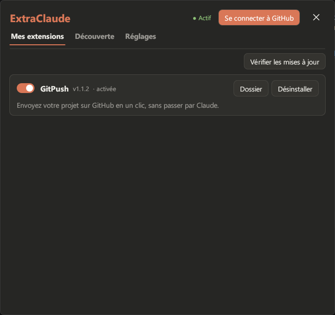

# ExtraClaude

**Ajoutez des extensions (mods, add-ons) à l'application Claude desktop sur Windows.**



ExtraClaude est le gestionnaire d'extensions de Claude desktop : il installe, active et met à jour
les extensions de l'organisation [Better-Extension-Claude](https://github.com/Better-Extension-Claude),
comme [GitPush](https://github.com/Better-Extension-Claude/GitPush) (envoyer son projet sur GitHub
en un clic). Sans lui, les extensions ne démarrent pas.

Ce ne sont pas des serveurs MCP : les extensions ajoutent des boutons, des fenêtres et des
fonctions à l'application Claude elle-même, et réagissent à ce que fait Claude Code.

> Projet non officiel, sans lien avec Anthropic. Claude est une marque d'Anthropic.

## In English

**ExtraClaude is an unofficial add-on manager for the Claude desktop app on Windows.** It lets
you install, enable and update extensions (mods) that add buttons, windows and features to
Claude desktop, such as [GitPush](https://github.com/Better-Extension-Claude/GitPush), which
pushes your project to GitHub in one click. These are not MCP servers: they extend the Claude
app itself and react to Claude Code events through hooks.

Download `ExtraClaude.exe` from the [latest release](https://github.com/Better-Extension-Claude/ExtraClaude/releases/latest),
run it and click **Installer**. A puzzle button then appears in Claude's sidebar. The interface
is in French. Not affiliated with Anthropic.

## Installer

1. Téléchargez `ExtraClaude.exe` dans la [dernière version](https://github.com/Better-Extension-Claude/ExtraClaude/releases/latest).
2. Lancez-le, choisissez où l'installer, puis cliquez sur **Installer**.
3. Ouvrez Claude : un bouton puzzle apparaît en bas de la barre latérale, à gauche de
   l'engrenage des paramètres. Il ouvre ExtraClaude.

## Utiliser

- **Découverte** : les extensions disponibles. **Installer** les télécharge et les lance.
- **Mes extensions** : activez ou désactivez chaque extension, mettez-la à jour, ouvrez
  son dossier ou retirez-la.
- **Réglages** :
  - où sont rangées les extensions (par défaut `%USERPROFILE%\ExtraClaude\Extensions`).
    Changer de dossier y déplace les extensions ;
  - l'apparence : comme Claude, clair ou sombre, et chaque couleur des deux thèmes.
    Toutes les extensions suivent ce réglage ;
  - les mises à jour d'ExtraClaude : il se met à jour tout seul (à l'ouverture de Claude
    et de la fenêtre ExtraClaude). Ça peut se décocher ; **Mettre à jour** et **Vérifier les mises
    à jour** restent disponibles.

Les extensions ne se mettent à jour que quand vous le demandez : **Vérifier les mises à
jour** dans Mes extensions, puis **Mettre à jour** ou **Tout mettre à jour**.

Une extension activée démarre avec Claude et se ferme avec lui. Une extension désactivée
ne démarre plus.

Certaines extensions sont privées : **Se connecter à GitHub** les affiche si votre compte
y a accès. Un code s'affiche (il est déjà copié) : collez-le sur la page GitHub qui
s'ouvre. ExtraClaude ne contient aucun secret, et la session est gardée chiffrée pour
votre compte Windows.

## Extensions disponibles

| Extension | Ce qu'elle fait |
|---|---|
| [GitPush](https://github.com/Better-Extension-Claude/GitPush) | Envoyez votre projet sur GitHub en un clic, sans passer par Claude. |

---

## Pour les développeurs

### Compiler

Rust, chaîne GNU (`stable-x86_64-pc-windows-gnu`) :

```bash
bash build.sh
```

L'exe est dans `dist/ExtraClaude.exe`.

### Comment ça marche

ExtraClaude est le **seul** hook de Claude Code (`~/.claude/settings.json`) :
`ExtraClaude.exe --hook` lit l'événement sur son entrée standard, lance les extensions
activées au `SessionStart`, puis envoie l'événement à chaque extension qui l'écoute, sur
son pipe nommé `\\.\pipe\betterext-<id>`. Il rend la main sans rien écrire : une
extension ne peut pas bloquer Claude.

L'état (extensions activées, dossier des extensions) et le thème sont dans
`%LOCALAPPDATA%\BetterExt\` (`state.json`, `theme.json`).

### Écrire une extension

Une extension est un dossier qui contient `extension.json` et son exe :

```json
{
  "id": "mon-extension",
  "name": "Mon extension",
  "version": "1.0.0",
  "description": "Ce que l'extension apporte, en une phrase.",
  "exe": "mon-extension.exe",
  "start": [],
  "events": ["PreToolUse", "PostToolUse"]
}
```

- `id` : lettres minuscules, chiffres et tirets, stable (pipe, réglages).
- `version` : à monter à chaque publication (c'est ce que compare « Mettre à jour »).
- `exe` : relatif au dossier du manifeste.
- `start` : arguments du lancement en début de session. Absent : jamais lancée par ExtraClaude.
- `events` : événements reçus (`"*"` pour tous) parmi `SessionStart`, `SessionEnd`,
  `UserPromptSubmit`, `PreToolUse`, `PostToolUse`, `Notification`, `Stop`,
  `SubagentStop`, `PreCompact`. Chacun arrive comme le JSON du hook de Claude, sur une ligne.

Le crate `sdk` (`betterext`) fournit le nécessaire :

```rust
betterext::process::single_instance("Local\\mon-extension");
betterext::events::listen("mon-extension", |event| { /* serde_json::Value */ });
let (rect, scale) = betterext::claude::rect().unwrap(); // fenêtre de Claude
let palette = betterext::theme::current();               // couleurs du thème choisi
```

Règles :

1. Une seule instance, et se fermer quand Claude se ferme (`claude::is_open()`).
2. Couleurs : toujours celles de `theme::current()`, relues régulièrement.
3. Réglages propres dans `betterext::extension_data_dir(id)`.

`sdk/examples/echo.rs` est une extension complète qui note les événements reçus.

Pour installer une extension en cours de développement comme le ferait un utilisateur :

```bash
ExtraClaude.exe --add dist\extension.json
```

### Publier

Un dépôt dans l'organisation `Better-Extension-Claude`, avec une **release** dont les
fichiers sont `extension.json` et l'exe (plus ce dont l'extension a besoin). L'onglet
Découverte la trouve grâce à `extension.json`, et l'installation copie tous les fichiers
de la release.

Une extension publique s'ajoute ensuite à [`catalogue.json`](catalogue.json), la liste
de l'onglet Découverte. Une extension privée n'y va pas : elle s'affiche d'elle-même pour
les comptes GitHub qui y ont accès. `ExtraClaude.exe --discover` affiche ce que voit
l'onglet Découverte.
